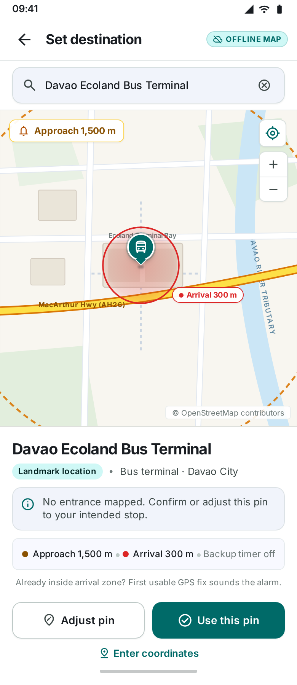

# Pilot map design review

Date: November 5, 2026. Status: final light Stitch proposal approved; native implementation, asset generation and build/data checks complete. The Infinix passed focused offline rendering, selection checks and the final 200% text layout check. Comparative performance and ride checks remain open.

## Final proposal

Stitch screen: `projects/4209751567387052102/screens/20e4cd2a2c6947b9b5325d80fb5889a8`. The PNG above is exported from the final rendered variant, not an Android device capture.

Visual review confirmed the flat mobile artboard, sans-serif headings, unobscured approach label, all three pin actions, missing-entrance explanation, first-fix warning, clean road casing and OSM attribution. The illustrative approach/arrival circles use a 5:1 radius ratio. Earlier drafts clipped actions, used serif headings, suggested sound playback during setup, or included a verification seal; those drafts are superseded. This review does not establish TalkBack behavior, large-text fit, actual map coverage, measured contrast or device performance.

Stitch offered optional follow-up designs for the pin-adjustment flow, coordinate-entry modal and dark-mode counterpart. Existing coordinate entry remains part of the app; no additional feature scope is approved by these suggestions.

## Design target

Use the existing [Para Android v1 Stitch project](https://stitch.withgoogle.com/projects/4209751567387052102). Keep Para's light interface, Inter headings/body, telemetry-only JetBrains Mono, teal actions, amber dashed approach ring and crimson solid arrival ring. Add source-backed geographic context: warm neutral buildings, pale green parks, blue water, differentiated major/local roads and dashed walking paths. The map remains the largest setup element.

The landmark confirmation state must show name/type/location context, distinguish a landmark anchor from an entrance, and offer **Use this pin**, **Adjust pin**, and **Enter coordinates**. With no source-backed entrance, show: “No entrance mapped. Confirm or adjust this pin to your intended stop.” All actions must remain reachable above the navigation inset. Selecting or inspecting a destination is silent. Retain the first-fix arrival warning and existing ring/timer draft.

Stitch geography is illustrative. Its named buildings, waterways and pins are not evidence of real-world geometry, verified entrances, or vehicle stopping access. Production geography must come from the source extract. A drawn park or walking path does not establish public access.

## Source and unchanged baseline

The cached Geofabrik Philippine OSM PBF matches the source recorded in the existing map notice:

- Source size: 612,751,019 bytes.
- SHA-256: `ba1749901aa7559084dda822f1e2716324208fab8646b8de5309cef6206a5c51`.
- Pilot bounds: west 125.51, south 6.99, east 125.89, north 7.48.
- Existing bundled streets: 18 packs, 129,904,542 bytes, 75,435 tiles.
- Existing public search database: 41,664,512 bytes before APK compression.

The Infinix had no live Para trip and its data-directory total was 168,184 KiB before this update. A USB reconnect enabled installation with saved data preserved. The API 37 emulator stayed offline and was stopped. After testing, the phone returned to Wi-Fi on, airplane mode off, 100% text, a five-minute screen timeout and USB stay-awake off. Para returned to its System theme.

A read-only source inventory found 217,814 building-way candidates, 6,697 walking-way candidates, 471 water-area-way candidates, 3,502 park/land-use-way candidates and 705 entrance nodes. The inventory counts ways with at least one vertex inside the pilot bounds and entrance nodes inside the bounds, using mutually exclusive way categories. It does not assemble relations or validate output geometry. These counts must not be presented as packaged feature totals or verified public entrances.

The synthetic extraction/normalization/PMTiles fixture passes polygon-hole preservation, separately tagged outer-way suppression, boundary-only entrance association, border clipping and restricted-path tags. An independent decoder also confirms the courtyard remains empty after tiling. The stronger tagged-member fixture first failed and exposed the duplication bug; the finalizer fixes it and is now required by the writer.

## Implemented data preparation

The following rules are implemented in the pilot extraction/normalization pipeline:

| Content | Required treatment |
| --- | --- |
| Building footprints | Pilot polygon/multipolygon geometry, stable source ID, name where present; retain holes and avoid duplicate relation/member rendering |
| Parks and land use | Explicit source classification, appropriate zoom filtering and subdued fills; avoid claiming all green areas are publicly accessible parks |
| Water areas | Handle lake/riverbank/reservoir polygons and multipolygon holes; retain existing river lines; coastal-water fill needs valid coastline assembly or a separately attributed land/water source |
| Walking paths | Preserve source class and access restrictions, distinguishing footways/path/steps; lines are geographic context, not a navigable pedestrian graph |
| Road hierarchy | Retain source highway class and enough structure for consistent casing/width/label hierarchy; avoid drawing duplicate national and pilot road geometries |
| Entrances | Retain OSM node IDs, entrance/access tags and source-backed landmark association. Do not assign an entrance to the nearest landmark solely by distance; unrelated buildings can be adjacent |
| Regional continuity | Retain whole-feature ownership or equivalent clipped geometry with buffers; handle holes, tile seams and pilot edges without gaps or doubled features |
| Packaging | Keep local-only data, versioned metadata/hashes and atomic copy behavior. Measure pilot detail separately from the unchanged nationwide baseline |

If an entrance cannot be reliably associated, use the approved landmark-confirmation fallback. Never label a general entrance as a bus drop-off, move a confirmed destination automatically, snap raw tracks to roads, or change alarm distance semantics.

## Generated assets and software checks

| Item | Result |
| --- | --- |
| Buildings / land use / water areas | 217,878 / 2,756 / 512 features after normalization |
| Classified road / path ways | 40,809 / 6,697; 289 unbuilt/proposed/abandoned road ways removed |
| Polygon holes | 79 retained; the courtyard fixture also stays empty after encoding |
| Entrances | 705 source nodes; 242 boundary-associated entrances across 199 named area landmarks. Of these, 189 entrances across 154 landmarks match IDs in the existing public search catalog. Unsupported categories/relations retain the confirmation fallback; do not claim every source entrance is searchable |
| Invalid areas | 24 invalid assembled areas rejected during full-source processing; this counter is not limited to the pilot |
| Archive | 20,345,165 bytes (19.4 MiB), 5,793 tiles; SHA-256 `e3f2bd3875a7aa2da54f2447910ecea7221b4d023fdada1b968158eaf28660c9` |
| Full archive validation | Hash/header/schema and every tile/feature geometry stream independently decoded |
| Native code | Manual adjustment disables landmark snapping; confirmation retains ring/timer draft. Zoom controls, semantic ring labels, raw-path start/end markers and path framing implemented |
| Tests | Seven trip/deadline tests plus two light/dark style integrity tests pass. Style checks cover JSON parsing, unique layer IDs, valid source references, local URLs and camera-ramp structure; they do not execute the native renderer |
| Build / lint | Debug APK and unsigned release AAB build. Lint: 0 errors, 25 warnings, 1 hint. APK native-library ZIP alignment check passes with `-P 16` |
| Packaging | APK 235,803,409 bytes (~224.9 MiB); unsigned AAB about 192.8 million bytes (~183.9 MiB). Both contain all four pilot assets. Measure Play-delivered size separately |
| Performance | Buildings are gated to zoom 15, paths to 14. Pilot-base layering prevents national-road overdraw inside the detail area. No phone speed, memory, battery or storage improvement is claimed without measurements; initial copying adds another internal copy of the pilot archive |

## Focused Infinix evidence

- Airplane mode on, Wi-Fi off: real Ecoland terminal-area buildings, streets, local labels and rings render. Light and dark captures were reviewed. The initial fixed-height map hid its attribution behind the footer; the corrected confirmation mode uses remaining height and keeps attribution visible.
- Missing-entrance guidance, manual adjustment mode and explicit confirmation passed. Start trip becomes available after confirmation; no trip was started.
- Set approach to 2,000 m, arrival to 250 m and backup to 2 minutes. All values survived selecting another landmark and entering custom coordinates.
- Polyclinic Davao exposes source-associated entrances; selecting one shows the mapped-entrance/non-verified-drop-off message. Two exposed private entrances at University of the Immaculate Conception were disabled.
- At 200% text, all three actions were reachable, but header/credits crowded out the map. Shorter labels and condensed map credits restored the map viewport. On the final retest, the map, credits and all three pin actions were visible. Full TalkBack and Switch Access remain open.
- New data-directory total: 188,080 KiB (increase 19,896 KiB; block-rounded, not just archive bytes). One foreground setup observation: PSS 236,098 KiB, RSS 267,116 KiB, swap PSS 102,410 KiB. These are a single debug-build sample, not a performance comparison or budget. The first installed build reported Activity cold launch 1,665 ms; that is not map-ready time.
- Changing system font scale recreated the unsaved setup state. The 200% layout check uses a fresh setup. Retained ring/timer evidence applies to in-app selection flows, not configuration-change persistence; keep unsaved-draft rotation/font-change persistence as a follow-up.

The original 18 national packs and public search database are unchanged. The pure style factory is separated from the Android view for direct testing. No Organic Maps implementation/assets, new runtime SDK, download capability or routing engine was added.

## Review and implementation gates

- [x] Generate, refine, export and visually inspect the final Stitch light landmark-confirmation proposal.
- [x] Obtain the user's approval of the final light proposal.
- [x] Confirm the map/selection design before production UI implementation, following the requested design-first sequence.
- [x] Implement and validate pilot geometry generation, including polygon holes and duplicate handling.
- [x] Implement and build-check native map styling and landmark/entrance confirmation with draft retention. Runtime interaction verification remains open.
- [ ] Compare map startup, rendering, memory and storage with the baseline on physical devices.
- [ ] Complete offline, accessibility and ride checks in the main acceptance checklist.

The [map improvement plan](<Para Map Improvement Plan.md>) defines the full approved scope. Record design references and source inventory results here as they become available; keep implementation and physical verification status separate.
